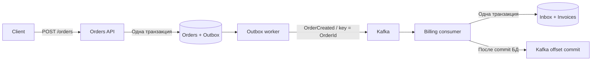

# .NET + Kafka + PostgreSQL: Outbox / Inbox

Учебный проект на .NET 10: Orders API сохраняет заказ и публикует `OrderCreated`, Billing API создаёт счёт. У каждого сервиса своя PostgreSQL. Общих транзакций между базами и Kafka нет.



## Запуск

Нужны Docker Engine / Docker Desktop с Linux containers и Docker Compose v2. Для локальной сборки — .NET SDK 10; для smoke-теста — PowerShell 7 (`pwsh`, также доступен для Linux/macOS).

```sh
docker compose up -d --build
docker compose logs -f orders-api billing-api
```

После запуска API:

```sh
curl -X POST http://localhost:5080/orders -H "Content-Type: application/json" -d '{"amount":125.50,"currency":"EUR"}'
# Ответ 201: { "orderId": "...", "eventId": "..." }
curl http://localhost:5080/orders/ORDER_ID
curl http://localhost:5081/invoices/ORDER_ID
```

Счёт появляется асинхронно: до обработки события последний запрос возвращает 404. В PowerShell создание заказа выглядит так:

```powershell
$order = Invoke-RestMethod http://localhost:5080/orders -Method Post -ContentType 'application/json' -Body '{"amount":125.50,"currency":"EUR"}'
Invoke-RestMethod "http://localhost:5081/invoices/$($order.orderId)"
```

`GET /health` каждого API — liveness, не проверка доступности Kafka/БД. API слушают только localhost на 5080/5081. PostgreSQL доступны на 55432/55433, Kafka — на 19092. Учётные данные `demo/demo` предназначены для этого локального стенда.

## Что происходит при сбоях

| Момент сбоя | Результат |
|---|---|
| До commit заказа | Ни заказа, ни Outbox-события |
| Kafka недоступна | Заказ принят, Outbox остаётся pending и повторяет отправку |
| Kafka приняла событие, но `published_at` не сохранён | Возможна повторная публикация с тем же EventId |
| Billing падает до commit БД | Inbox и счёт откатываются, offset не подтверждён |
| Billing падает после commit БД, до commit offset | Событие повторяется; Inbox исключает повторное создание счёта |

`orders + outbox` пишутся одной локальной транзакцией. Publisher выбирает одну строку с `FOR UPDATE SKIP LOCKED`, держит блокировку до подтверждения Kafka и обновляет `published_at`. Другие экземпляры publisher пропускают занятую строку. Цена простоты — транзакция БД остаётся открытой во время сетевого вызова; таймаут публикации 10 секунд, повтор через 2 секунды.

В Billing уникальный ключ Inbox — `(consumer, event_id)`. `INSERT ... ON CONFLICT DO NOTHING RETURNING` решает, нужно ли выполнять бизнес-операцию. Inbox и счёт коммитятся вместе. `EnableAutoCommit=false`, `EnableAutoOffsetStore=false`; ручной `Commit(record)` вызывается только после commit PostgreSQL. При ошибке consumer закрывается и пересоздаётся, чтобы не перейти к следующему сообщению и не подтвердить offset поверх необработанного события.

Это **at-least-once delivery с идемпотентным эффектом внутри Billing PostgreSQL**. Producer idempotence не устраняет окно между отправкой Kafka и commit Outbox. Внешние платежи, email и другие побочные эффекты требуют своего механизма идемпотентности или следующего Outbox.

## Проверка

### NUnit

```sh
# Unit: Docker не нужен
dotnet test tests/Messaging.UnitTests -c Release
# Integration: запущенный Docker с Linux containers
dotnet test tests/Messaging.IntegrationTests -c Release
# Оба набора
dotnet test -c Release
```

`Messaging.UnitTests` содержит 22 проверки валидации: границы суммы и точности PostgreSQL, формат валюты, идентификаторы и версия события. Общая валидация используется и API, и consumer; consumer также отклоняет слишком большую сумму и валюту в нижнем регистре до обращения к БД.

`Messaging.IntegrationTests` содержит 8 тестов с настоящими PostgreSQL и Kafka через Testcontainers:

- атомарная запись заказа и соответствующего Outbox-события;
- откат заказа при ошибке INSERT в Outbox;
- последовательная и конкурентная (8 вызовов) дедупликация Inbox;
- откат Inbox при ошибке INSERT счёта и успешная повторная обработка;
- отсутствие записи Inbox для невалидного события;
- полный путь Outbox → Kafka → Inbox, replay и подтверждение offset повторного события;
- отсутствие commit offset при ошибке БД и восстановление после устранения ошибки.

Тесты создают свои контейнеры, случайные порты и topics; Compose предварительно запускать не нужно. В одном PostgreSQL-контейнере создаются отдельные базы `orders` и `billing`, схемы и обработчики берутся из production-кода. Контейнеры удаляются после тестов, данные demo не затрагиваются. PostgreSQL: `postgres:17`; Kafka: `confluentinc/cp-kafka:7.8.0`. Первый запуск скачивает образы. Нужен доступ к Docker API и registry; без Docker интеграционные тесты завершаются ошибкой setup, а не незаметным skip. Категории NUnit: `Unit`, `Integration`.

### Smoke через HTTP и Docker Compose

```sh
dotnet build -c Release
pwsh -File scripts/smoke.ps1
```

Smoke-тест требует запущенного Compose. Создаёт заказ, проверяет сумму/валюту счёта, сбрасывает `published_at`, ждёт повторной обработки того же EventId и проверяет единственность Inbox/счёта. Затем останавливает Kafka, создаёт заказ и проверяет доставку после восстановления. Kafka запускается обратно в `finally`. Тест меняет только данные стенда, не удаляет существующие записи.

GitHub Actions выполняет сборку, оба набора NUnit, сохраняет TRX-отчёты, затем запускает Compose и smoke-тест на Linux. Наличие workflow не означает, что CI уже запускался.

Посмотреть данные:

```sh
docker compose exec orders-db psql -U demo -d orders -c "TABLE outbox;"
docker compose exec billing-db psql -U demo -d billing -c "TABLE inbox;"
docker compose exec billing-db psql -U demo -d billing -c "TABLE invoices;"
```

## Запуск .NET из IDE

```sh
docker compose up -d orders-db billing-db kafka kafka-init
dotnet run --project src/Orders.Api --no-launch-profile --urls http://localhost:5080
# В другом терминале:
dotnet run --project src/Billing.Api --no-launch-profile --urls http://localhost:5081
```

Настройки по умолчанию соответствуют опубликованным портам Compose. Переопределения: `ConnectionStrings__Database`, `Kafka__BootstrapServers`, `Kafka__Topic`. Topic по умолчанию `orders.created.v1`, consumer group `billing-v1`. Не запускайте одновременно локальные API и контейнеры API с теми же портами.

## Структура

- `src/Orders.Api` — HTTP API, таблицы Orders/Outbox, фоновый publisher.
- `src/Billing.Api` — Kafka consumer, Inbox/Invoices, HTTP API чтения счетов.
- `src/Messaging` — контракт события и небольшой SQL helper.
- `compose.yaml` — два PostgreSQL, Kafka в KRaft, создание topic, два API.
- `scripts/smoke.ps1` — проверка через реальные Kafka и PostgreSQL.
- `tests/Messaging.UnitTests` — NUnit без инфраструктуры.
- `tests/Messaging.IntegrationTests` — NUnit + Testcontainers.

## Границы demo

- Один broker, replication factor 1: стенд не моделирует отказоустойчивый кластер. Kafka и обе базы сохраняются в volumes.
- SQL-схема создаётся при старте через `CREATE TABLE IF NOT EXISTS`; эволюция схемы требует миграций.
- Некорректное/неподдерживаемое событие логируется и повторяется без пропуска offset; требуется исправление оператором. DLQ и ограниченный retry намеренно не реализованы.
- Очистки Inbox/Outbox нет. В production срок хранения Inbox должен покрывать возможные replay и retention Kafka.
- `OrderId` — ключ Kafka, но несколько publisher могут переставить события одного агрегата. Здесь на заказ приходится одно событие; для последовательности изменений нужен отдельный контроль порядка.
- Повтор HTTP POST создаёт новый заказ. HTTP idempotency key не реализован.
- Нет аутентификации, TLS, schema registry, метрик и distributed tracing. Валюта валидируется как 3 заглавные латинские буквы, без справочника ISO.
- Фиксированные NuGet-версии задаются в `Directory.Build.props`; образы .NET/PostgreSQL используют major-теги с обновлениями patch.

Остановка с сохранением данных: `docker compose down`. Полный сброс **всех данных demo**: `docker compose down -v`.

## Документация

- [Confluent .NET client: доставка и offsets](https://docs.confluent.io/kafka-clients/dotnet/current/overview.html)
- [PostgreSQL: SELECT и SKIP LOCKED](https://www.postgresql.org/docs/17/sql-select.html)
- [Npgsql: транзакции](https://www.npgsql.org/doc/basic-usage.html#transactions)
